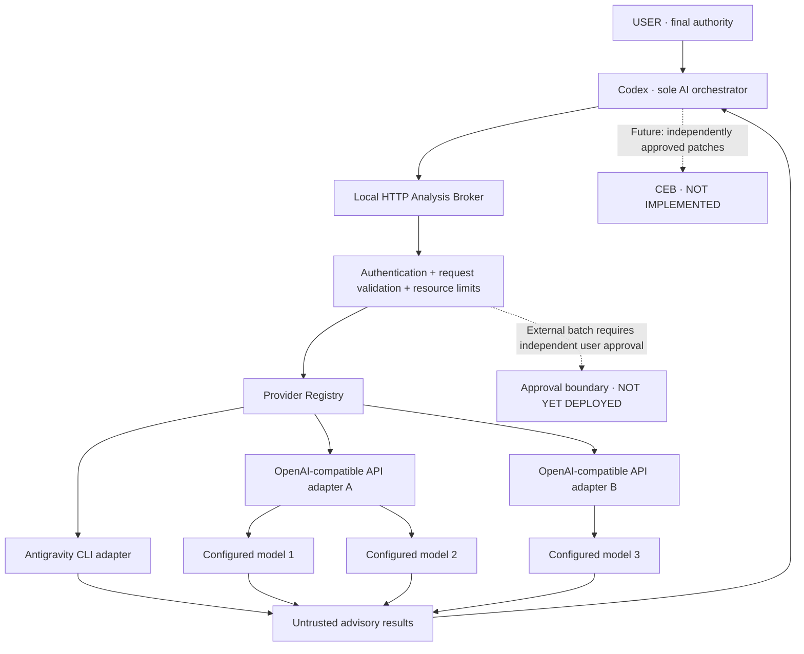

<div align="center">

# Codex Worker Orchestrator

**A local-first, security-conscious orchestration foundation for advisory AI workers.**

*Codex coordinates. Providers analyze. The user authorizes.*

[](#project-status)
[](#requirements)
[](#security-model)
[](#requirements)

**English** · [Tiếng Việt](docs/README.vi.md)

</div>

> [!IMPORTANT]
> **Early-stage infrastructure, not an end-user application.** External API batch dispatch is **denied by default** until independently verified user approval is implemented. Passing mocked tests does not establish production security or prove live provider integration.

## Why this project?

Most multi-model setups make it easy to send tasks to several models. This project focuses on the harder question: **who is allowed to decide, approve external transmission, and change project files?**

The answer is explicit:

- **USER** retains final authority and must independently approve sensitive actions.
- **Codex** is the only AI orchestrator: it chooses advisory tasks and evaluates evidence.
- **Analysis Broker / Provider Registry** are deterministic infrastructure: validate, dispatch and return data.
- **Antigravity CLI and API models** are peer **advisory-only workers**. They cannot orchestrate, delegate, or execute project changes through this architecture.
- **Controlled Execution Broker (CEB)** is a *future* capability, not currently implemented.

## Architecture



The registry can perform **bounded parallel dispatch** and preserve per-target results; it does **not** determine which answer is correct. That decision remains with Codex and, ultimately, the user.

## Project status

| Component | Current state |
|---|---|
| Provider contract, configuration validator and registry | Implemented |
| Antigravity CLI adapter | Implemented; mocked tests |
| OpenAI-compatible API adapter | Implemented; mocked tests |
| Multi-provider/model bounded dispatch | Implemented in registry |
| Runtime provider configuration | Implemented |
| `GET /health` and legacy `POST /v1/analyze` | Implemented; compatibility tests |
| Authenticated `POST /v1/analyze/batch` | Implemented, **authorization denied by default** |
| Cryptographic approval verification core | Isolated module; not wired to production dispatch |
| Windows independent approval application / protected IPC | Design / future work |
| Controlled Execution Broker and end-user UI | Future work |

**Last locally reported test result:** 76/76 passing (2026-10-13), using Node's test runner and mocked workers. Re-run tests on your machine; this is **not** a claim about live API calls or deployed approval security.

## Requirements

- Node.js with built-in `fetch` and `node:test` support (use a maintained LTS release).
- Git.
- Windows PowerShell 7+ recommended for the included synchronization script.
- Antigravity CLI (`agy`) only if you intend to exercise the real legacy worker route; **not required for mocked tests**.
- Optional: [GitHub CLI](https://cli.github.com/) (`gh`) to create and connect your repository.

No third-party Node packages are required by the existing broker/test setup.

## Quick start

```powershell
# Run from the repository root
node --test

# Start the local analysis broker
.\broker\start-broker.ps1
```

By design, the HTTP listener binds to **`127.0.0.1:8765`**. To check it from another PowerShell session:

```powershell
Invoke-RestMethod http://127.0.0.1:8765/health
```

The legacy analysis route delegates to the configured Antigravity adapter. **Starting the broker does not imply that API dispatch has been approved**. See [`broker/README.md`](broker/README.md) for existing endpoint-level safeguards.

## Provider configuration

The default runtime configuration is [`broker/config/providers.json`](broker/config/providers.json). A descriptive example lives at [`broker/config/providers.example.json`](broker/config/providers.example.json).

The registry supports multiple independently configured API providers and model allowlists. Provider endpoints are fixed in server-side configuration—not supplied by clients.

```json
{
  "id": "example-provider",
  "kind": "api",
  "enabled": false,
  "baseUrl": "https://api.example.invalid/v1",
  "timeoutSeconds": 120,
  "models": ["model-a", "model-b"],
  "defaultModel": "model-a",
  "credentialEnv": "EXAMPLE_PROVIDER_API_KEY"
}
```

This is an illustrative **provider entry**, not a full config file. The `.invalid` host is deliberately nonfunctional. API credentials must be supplied through the configured environment variable at execution time; **do not put keys into Git, JSON, scripts, screenshots or issues**. Enabling a provider alone does **not** bypass the independent approval requirement for batch dispatch.

## Security model

1. **Local first:** the HTTP service is bound to loopback, not exposed on a network interface. Loopback is not a replacement for authentication.
2. **Explicit delegation:** clients cannot invent provider URLs, credentials, tools or models outside validated configuration.
3. **Advisory data:** worker output is untrusted and never grants execution or approval authority.
4. **Bounded resources:** batch endpoint and registry limit payload size, target count, concurrency and timeouts.
5. **Separate credentials:** batch authentication tokens, provider API keys and future approval credentials serve different purposes.
6. **Deny-by-default external batch dispatch:** authentication alone is insufficient; no independent approval channel is deployed.
7. **Approval core is isolated:** signature verification and in-process one-time consumption are not a production approval interface; there is no trusted user-controlled signing UI or durable cross-process replay protection yet.

> [!WARNING]
> External API analysis sends task contents outside the local machine. Review the precise destination, model and task data before a future independent approval mechanism authorizes that transmission. Do **not** enable public access to the broker or circumvent deny-all authorization to test live providers.

Read [SECURITY.md](SECURITY.md) before changing authorization, process privileges or networking.

## Development workflow

Work locally, review changes, run tests, commit, then push to GitHub:

```powershell
# Review your changes
git status --short

# Stage ONLY the paths you intend to publish
git add broker/providers/approval-core.js broker/test/approval-core.test.js

# Test, commit staged changes and push the active branch
.\scripts\sync.ps1 -Message "feat: add isolated approval verification core"
```

The sync script **never stages files automatically**, runs `node --test`, checks the staged diff, commits only staged changes, and pushes the current branch to `origin`. To push already-committed changes, use `./scripts/sync.ps1` without a message.

Pull before beginning work on another device:

```powershell
git pull --ff-only
```

For contributions, see [CONTRIBUTING.md](CONTRIBUTING.md).

## Roadmap

- [x] Registry with multiple provider/model definitions
- [x] Antigravity and OpenAI-compatible adapters
- [x] Mock-tested bounded parallel dispatch
- [x] Runtime configuration and authenticated local batch endpoint
- [x] Isolated Ed25519 approval verification core
- [ ] Independent Windows user-approval UI and protected IPC
- [ ] Durable approval consumption, audit integrity and security review
- [ ] Live-provider integration after independent authorization is proven
- [ ] Controlled Execution Broker with exact-patch authorization
- [ ] Accessible desktop/web UI, setup wizard and multi-user documentation

## Contributing and license

The project is under active development. Contributions should preserve the authority hierarchy, fail-closed authorization and mocked-test isolation. See [CONTRIBUTING.md](CONTRIBUTING.md) and [SECURITY.md](SECURITY.md).

**License:** not selected yet. No open-source license is granted merely by making a repository public. A license must be chosen before community reuse/distribution is invited.

<sub>Independent community project; not an official OpenAI, Codex or Antigravity release.</sub>
