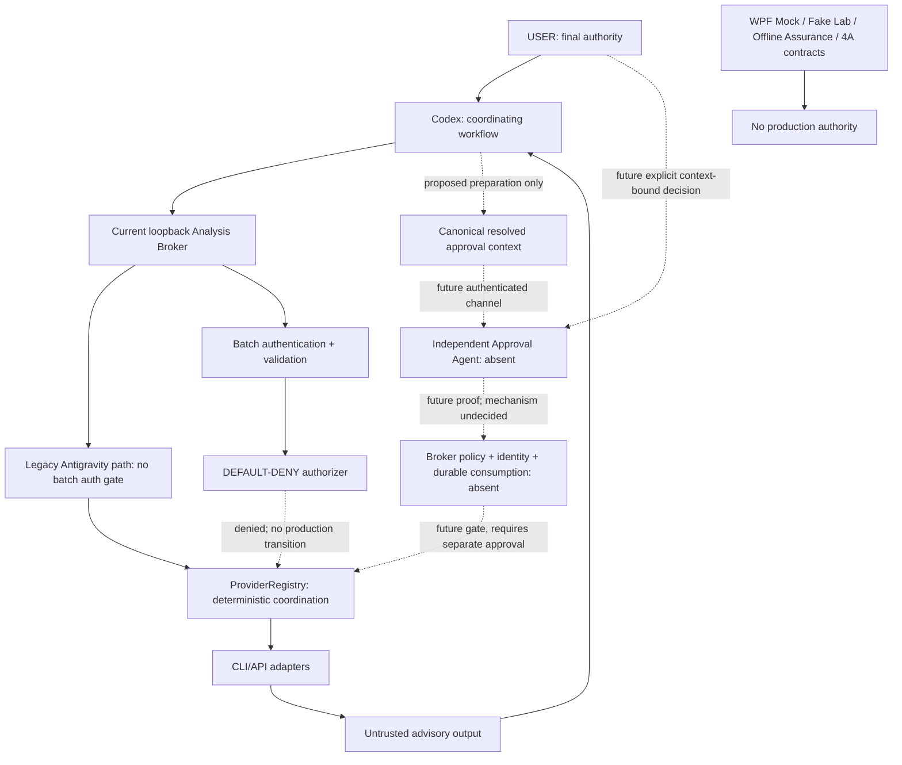

# Phase 4A: real-system architecture and integration blueprint

Audited baseline: `de01560a57f870268be4991e66988f9a6e188b4b` on `main`.
Source references below refer to that baseline unless marked **4A**. Source and
mocked tests establish implemented behavior; prior documentation, synthetic success
and the USER-reported five passing CI jobs do not establish live-system readiness.
No live worker, API, credential ceremony or external AI was invoked for this audit.

## Decision and eight-workstream disposition

GO for integrating this architecture and offline contract validation. GO for starting
the bounded, non-authorizing Phase 4B prerequisites below. NO-GO for real credential
operations, production authorization and deployment. No new synthetic hardening batch
is proposed. The useful next step is connecting existing components through one
reviewable request-preparation seam, with dispatch still disabled.

| Workstream | Delivered result |
| --- | --- |
| 4A-A | As-built inventory with actual code paths, dependencies, status and failures |
| 4A-B | Current execution trace and explicitly separate future authorized flow |
| 4A-C | Component responsibilities and prohibited boundary shortcuts |
| 4A-D | Schema v1 design contracts, existing-format reuse and semantic binding rules |
| 4A-E | Identity alternatives, threat assumptions and USER decisions left open |
| 4A-F | Offline Node contract tests; positive consistency always remains non-authorizing |
| 4A-G | Operational lifecycle assessment separating real code from modeled recovery |
| 4A-H | Consolidated blueprint, ranked gaps and ordered Phase 4B acceptance gates |

## As-built inventory

There is no repository-owned Codex task client, production Approval Agent, protected
IPC service, approval issuer, durable authorization store or Controlled Execution
Broker. Codex coordinates through an operator workflow; `ProviderRegistry` supplies
deterministic advisory coordination. `broker.js` is an **analysis** HTTP server,
not a general action executor. File placement under `broker/providers` does not
make the standalone cryptographic verifiers deployed authorization components.

| Source / implementation evidence | Responsibility and input → output | Actual dependencies | Trust / runtime classification | Failure conditions |
| --- | --- | --- | --- | --- |
| `broker/start-broker.ps1`; `broker/broker.js:192`, main block | Hardcoded local directory and Node startup → listener at `127.0.0.1:8765` | PowerShell, installed Node, local config | Runnable infrastructure; not started during 4A; loopback is not authentication | Invalid config/adapter bootstrap; port/listen failure has no explicit operational recovery |
| `broker/providers/config-loader.js:loadConfig`; `config.js:validateConfig` | Local JSON v1 → frozen normalized provider definitions | Built-in fs/path/net/URL; no packages | Operator-selected config is a trust input; no protected ownership check | Missing/malformed config, unknown fields, duplicate provider IDs, invalid URLs/models/timeouts/defaults; raw JSON parser does not reject duplicate properties or bound file size |
| `broker/config/providers.json`; `runtime.js:createRuntimeAdapters` | Enabled definitions → CLI/API adapter instances | Existing factories; process environment passed but API key read only on invocation | Checked-in CLI Antigravity enabled; both example APIs disabled and `.invalid`; construction is not a live integration test | Unsupported enabled CLI, missing enabled default; broker additionally requires Antigravity regardless of config default |
| `broker/broker.js:createBrokerServer`, `/health` | GET → `{ok,service,provider}` | Node http | Unauthenticated static liveness; does not test worker, credentials, approval or storage | No readiness or dependency signal; a healthy response does not mean dispatch is safe |
| `broker/broker.js:95`, legacy `/v1/analyze` validation/dispatch | `{task,effort?,timeout_seconds?}` → `{ok,request_id,provider,response,conversation_id,usage}` or sanitized failure | Registry, crypto UUID/hash-independent path, logger | Runnable legacy Antigravity route; **no batch token or USER-approval check**; not equivalent to DEFAULT-DENY batch | JSON/task/key errors; static null-body defect before `body.task`; 256 KiB text/body checks; worker failure maps 502 |
| `broker/providers/batch-security.js:validateBatch`, `handleBatch` | Authenticated `{targets}` → 403 by default; mocked authorizer can yield ordered `{ok,results}` | Node crypto; registry; `BatchGate`; env `BROKER_BATCH_AUTH_TOKEN` | Production batch gate deterministic and DEFAULT-DENY; authentication is not approval | Missing token configuration 503, bad token 401, media 415, oversize 413, invalid JSON/request 400, busy 503, authorization 403 |
| `batch-security.js:BatchGate` | AbortSignal → slot/release callback | In-memory queue | 2 active / 4 queued batches; state disappears on restart | Queue overflow or cancellation; no durable admission or independently bounded authorization callback |
| `broker/providers/registry.js:ProviderRegistry.validateRequest`, `dispatch`, `dispatchMany` | Configured target/request → advisory result or per-target sanitized failure in input order | Provider contract, timers, AbortController | Deterministic orchestration; caller must already have authority to invoke adapters; registry itself is not an authorizer | Unknown/disabled provider, invalid model/fields/timeout; timeout/cancel; adapter failure; direct registry batch lacks HTTP body/target-count bounds |
| `broker/providers/provider.js:validateProviderResult` | Worker object → frozen advisory field projection | None | Provider content untrusted; extra top-level instructions are discarded; usage remains untrusted object data | Missing/blank response, invalid conversation/usage types; no authority derived from contents |
| `broker/providers/antigravity.js:createAntigravityProvider` | Task/effort/timeout/signal → parsed CLI analysis | Built-in child_process; `agy` executable from PATH; inherited environment | Runnable adapter with mocked tests; plan/sandbox flags and subordinate prompt are not verified OS confinement or executable identity | Spawn/exit/JSON/status/denied-action failures; 2 MiB stdout; timer plus 10-second grace; kills child, not proven entire descendant tree |
| `broker/providers/openai-compatible.js:createOpenAICompatibleProvider` | Allowlisted model/task → advisory response | Built-in fetch, env key at call time, timers, streams | Runnable adapter with injected-fetch tests; disabled by checked-in config | Missing key, HTTP/network/JSON/response failures; 1 MiB body; abort/timeout; no real provider compatibility or DNS/egress assurance established |
| `broker/providers/approval-core.js:ApprovalVerifier`, `canonicalJson`, `sha256Text`, `configurationFingerprint` | Explicit trusted Ed25519 key/session, grants and targets → synchronous in-instance consumption receipts | Built-in crypto; caller clock/audit callback | Isolated cryptographic prototype; no issuer or production route integration; hash helpers reusable | Signature/session/expiry/scope/config/replay failures; in-memory sets lost on replacement/restart; audit callback failure swallowed safely |
| `broker/providers/webauthn-approval.js:OfflineWebAuthnApprovalVerifier`, `batchSha256` | Caller-pinned origin/RP/credentials/session/config, synthetic proofs → atomic in-instance receipts | Built-in crypto and approval-core hashing/canonicalization | Offline synthetic verifier, not production WebAuthn approval; no ceremony or trusted enrollment | Strict binding/signature/flags/algorithm/counter/replay rejection; no authenticated trust-anchor provisioning or durable replay |
| `approval-agent/ApprovalAgent.Mock/App.xaml`, `MainWindow.xaml.cs`, `Services/MockProposalSource.cs`, `Models/ApprovalProposal.cs`, `ViewModels/ApprovalViewModel.cs` | Fixed `.invalid` proposal → rendered exact task/hash and in-memory Pending/ApprovedMock/Rejected/Expired | Installed .NET 8 WindowsDesktop/WPF | Hallmark mock; no request receiver, issuer, IPC, dispatch or persistence | Expiry refresh/button guards; Escape rejects; terminal states cannot reopen; display hash does not identify requester or grant authority |
| `approval-agent/ApprovalAgent.Mock/Services/WebAuthnCapabilityDiagnostics.cs:WindowsWebAuthnNativeApi` | System32 library/version/platform-availability queries → sanitized diagnostic JSON | NativeLibrary/Marshal and two read-only native exports | Historical/local capability observation only; not credential or USER approval | Missing DLL/export/HRESULT/exception → unknown/unavailable; no make/get/enumerate/delete operation |
| `experiments/webauthn-contract-lab/contracts.js`, `contracts.test.js` | Synthetic CBOR/COSE/client data → interoperability checks | Node crypto, offline verifier; ephemeral test-only keys already in baseline | Synthetic-only test harness, part of Node tests | Bounded malformed data and mismatched proof fail; no production registration lifecycle |
| `experiments/webauthn-windows-lab/Program.cs`, `LabWorkflow.cs`, `FakeNativeWebAuthn.cs`, `RecoveryJournal.cs`, `SyntheticJournalStore.cs`, `TrustBoundary.cs` | Fake native data/inventory/journal transitions → synthetic states and bounded recovery results | Installed .NET 8 base libraries; no PackageReference/ProjectReference | Experimental; 60 tests, in-memory store/ledger; ABI declarations do not perform native calls | Unknown outcomes, stale revisions, collisions, lost ledger, revocation/cleanup failures block synthetic trust; real restart durability absent |
| `experiments/webauthn-offline-assurance/Program.cs`, `Assurance.cs`, `TraceContract.cs`, `SyntheticCandidate.cs` | Manifest/registry/evidence/revision → policy/report or allowlisted content candidate/audit | Installed .NET 8 base libraries, bounded local reads/hashes | Observational experiment; 197 self-tests; fixture candidate report deliberately evidence-incomplete | Schema/lineage/trace/bounds/digest/member/content failures; caller-selected repo and hashes do not authenticate producer |
| `.github/workflows/ci.yml`; `broker/test`; both Lab test harnesses; `ApprovalAgent.MockTests/Program.cs` | Committed source → mocked regressions and builds | Node 22/24; .NET 8; GitHub action environment when CI runs | Four Node matrix jobs + one Windows .NET job; tests/builds do not prove live integration | Any failed test/build blocks checks; remote results not independently fetched during 4A |

The README's historical 76-test result is stale; execution, not that paragraph,
establishes the measured baseline. The actual baseline regression command reports
29 Mock, 60 Fake Lab, 197 Offline Assurance and 105 Node tests (391 total).

## Trust boundaries and responsibilities



Orchestrator validates and normalizes inputs, resolves configured targets, preserves
ordered batch identity and collects advisory output. It cannot grant final approval.
Broker authenticates callers where implemented and ultimately must deny if any
identity, scope, expiry, provenance or replay precondition is missing. Deterministic
infrastructure is not an autonomous agent. The future Approval Agent displays the
complete effective action and independently captures USER intent; its receiver and
trust chain do not exist. Provider adapters perform only the already-authorized
advisory transmission and enforce cooperative timeout/resource behavior.

Prohibited shortcuts: reusing batch authentication as approval; treating a model's
`approved` field, valid signature, executable path/PID, hash or Hello prompt as USER
consent; wiring the boolean test authorizer to a proposal; accepting caller-selected
trust anchors; converting ApprovedMock to a production grant; recovering trust from
an ambiguous outcome; or using assurance reports as authorization. Registry access
inside the trusted process is not an independent security boundary.

## Current execution trace versus intended integration

Current runnable path: operator starts Node → config validated → enabled adapter
objects built → HTTP legacy request trimmed → registry invokes CLI → response
projected and logged. Batch instead validates authentication and targets, reserves a
slot, then returns `authorization_required` with the production default authorizer.
An injected test authorizer is used only by mocked tests to exercise dispatch.
There is no current path from a WPF click or an offline verification receipt into
either production dispatch gate.

The trace below is hypothetical and does not execute operations. **Approval of an
external transmission must precede that transmission.** An early advisory result
can come from fixed fixtures or a separately authorized existing scope; it cannot
justify transmitting the task first and obtaining approval afterward.

| Stage | Existing path / test evidence | Required input → output | Failure, timeout/cancellation and missing prerequisites |
| --- | --- | --- | --- |
| 1. USER task creation | External caller only; `broker/test/broker-http.test.js` valid POST case | Exact task and selected advisory scope → request | No repo task-entry client or authenticated task ownership; USER provenance cannot be inferred from HTTP JSON |
| 2. Normalization | `validateBatch` and legacy `body.task.trim()`; contract-lab normalized-byte test; approval-core canonical hash test | Raw task → `trim()` result, UTF-8 SHA-256 | No NFC or line-ending rewrite; verifiers hash supplied strings exactly; future display must receive effective text, not recompute another normalization |
| 3. Validation | `validateBatch`, `validateRequest`; invalid-request/model/config tests | Bounded request/config → validated planned targets | Unknown fields reject; batch 8 targets/256 KiB/50000 UTF-16 units; raw-parser and legacy null-body gaps below; no explicit application read deadline |
| 4. Provider/model selection | `config.js`, `runtime.js`, registry allowlist tests | Operator config + explicit target → enabled provider/model | No request URL/key override; default resolution differs by HTTP/registry surface; future preparation must snapshot actual resolved destination and parameters |
| 5. Advisory dispatch | Registry and adapter tests with fake spawn/fetch | Approved effective request + signal → advisory result | Registry timer aborts; adapters cooperate; early dispatch currently only legacy or mocked-authorizer path; no real new batch authority |
| 6. Aggregation | `dispatchMany`; input-order, concurrency, partial-failure tests | Ordered target list → ordered success/failure records | HTTP 2 parallel targets; direct registry default 4; failures isolated; no durable job or decision based on response contents |
| 7. Approval request preparation | Only fixed MockProposalSource exists; **4A** schema/checker specify future seam | Resolved task/destination/config/session/batch → complete display context | No dynamic production proposal factory or trusted receiver; expire/cancel before transmitting; future bounded transport required |
| 8. Exact action binding | Offline helpers/core and changed-field tests; **4A** context/config checks | Effective strings/routing/ordered IDs/parameters → task/batch/config/context digests | Existing boolean hook omits destination/config/batch/session; immutable snapshot and display provenance absent |
| 9. Approval verification | Standalone ApprovalVerifier and offline WebAuthn test suites | Trusted identity/keys/clock plus explicit decision proof → prototype receipts | No trusted issuer, enrollment, IPC, deployment identity or durable store; mock/design proof cannot enter this boundary |
| 10. Broker decision | `handleBatch`, authentication-alone-denies test | Policy + all essential authority evidence → deny now | Authorizer exceptions fail closed; asynchronous injected hook has no dedicated deadline; production design must verify/consume whole scope before dispatch |
| 11. Execution outcome | Advisory adapters only; partial failure and abort tests | Allowed advisory target → success/failure/uncertain future observation | No arbitrary filesystem/shell execution endpoint or CEB; abort cannot undo external receipt; no automatic retry of uncertain outcomes |
| 12. Audit/recovery | Legacy redacted console logs; prototype audit callbacks; fake journal tests | Sanitized identifiers/status → local observation or synthetic journal | No durable production audit/ledger/job recovery; restart invalidates current sessions and must not recover stale approval; missing audit evidence cannot become authority |

## Executable integration contracts (design v1)

**4A source:** `experiments/integration-contracts/contracts.schema.json`,
`check-contracts.js`, `fixtures/consistent-scenario.json`, `contracts.test.js`.
These are schema definitions and pure offline consistency checks, not routes,
production authorization tokens, an approval issuer or a new lifecycle service.
All versioned wrappers require `schemaVersion: 1` and
`designation: SYNTHETIC_DESIGN_ONLY`. Every checker result includes
`authorized: false` and `productionAuthorization: DEFAULT_DENY`, including positive
`CONSISTENT_NON_AUTHORIZING`. Unknown versions/fields and missing required fields
reject; invalid inputs receive fixed sanitized categories, never input text.

| Contract / schema definition | Required content and intended eventual seam |
| --- | --- |
| `request` | requestId, batchId, sessionId, createdAt, ordered targets; orchestrator ingress/preparation, no authority from session string |
| `target` | Existing registry-style id/provider/model/task/effort/timeoutSeconds; explicit resolved parameters; HTTP `timeout_seconds` maps at a future adapter boundary |
| `taskIdentity` | id, taskSha256, `ECMASCRIPT_TRIM_UTF8_V1`; derived from effective text before display/hash/transmission |
| `batchIdentity` | batchId, orderedTargetIds, existing domain-separated batchSha256; context also binds IDs because existing digest only covers provider/model/task tuples |
| `approvalRequest` | requestId, createdAt/expiresAt, complete ordered displayTargets and existing v1 approvalData; applicationIdentity/userIdentity fixed `UNESTABLISHED` |
| `decision` | requestId, contextSha256, decision/time/provenance, Pending→one terminal state; enum APPROVE_MOCK/REJECT/EXPIRED/CANCELLED, never real APPROVE |
| `proofEnvelope` | requestId/contextSha256, protocol NONE, authority NONE; intentionally incompatible with existing grant/assertion envelopes; no signature, credential or attestation fields |
| `brokerOutcome` | requestId/contextSha256, DENY, AUTHORITY_NOT_ESTABLISHED, DEFAULT_DENY; represents this design scenario's result only |
| `audit` | contract_checked, requestId/batchId, DENY/reason/time; excludes task, output, proof and credentials; no audit sink or persistence added |
| `cancellation` | requestId, NONE/CANCELLED_BEFORE_START/OUTCOME_UNKNOWN, operationState, retryPolicy; unknown requires MAY_HAVE_STARTED + RECONCILE_FIRST; standalone modeled observation, never evidence of real execution |
| `providerResult` | Bounded advisory response, ADVISORY_ONLY, authority NONE; instructions inside response remain untrusted content |
| `scenario`, `scenarioCollection` | Fixed fixtures connecting the above; collection checks duplicate request IDs within at most 8 records, without claiming persistent replay protection |

The schema file is authoritative for exact required keys, enums and bounds. The
checker interprets only its finite declared JSON Schema subset, then applies semantic
relationships and existing `validateConfig` v1. It is not a general schema framework;
unsupported evaluation keywords/references reject. Schema URIs are identifiers only,
never fetched. Configuration uses the existing validator instead of a parallel
provider schema. The fixture's enabled API definition is never passed to runtime
adapter construction, has a `.invalid` hostname and no key value.

Bounds: 262144 canonical JSON bytes, depth 16, 4096 visited values; 1–8 targets and
collection records; IDs 1–64 characters, model IDs up to 128, hashes exactly 64
lowercase hex, canonical 32-byte base64url nonces, display URLs up to 2048,
advisory fixture response up to 8192. Schema string lengths count Unicode code
points; task semantic validation additionally enforces the existing 50000 UTF-16-unit
runtime cap. Lone surrogates reject. General JSON input must be plain, dense,
bounded value data without accessors, functions, cycles or exotic objects.

Time uses positive safe-integer UTC Unix milliseconds, matching existing approval
expiry fields. Caller supplies deterministic `now`; this does not establish trusted
time. Lifetime is at most 300000 ms. APPROVE_MOCK/reject/cancel become stale at
`now >= expiresAt`; explicit EXPIRED is a valid non-authorizing terminal observation
only at/after expiry. No terminal state can return to Pending. Collection duplicate
detection is per invocation; repeated independent checks intentionally have no replay
state. Future production delivery must persist atomic consumption before effect.

Canonical JSON and task/config SHA-256 reuse `approval-core.js`; ordered batch digest
reuses `webauthn-approval.js:batchSha256`. **No verifier instance is constructed.**
The proposed effective config fingerprint covers:

```text
configurationFingerprint({
  configuration: validateConfig(configuration),
  targets: [ {id, providerId, modelId, destination, effort, timeoutSeconds}, ... ]
})
destination = normalizedProviderBaseUrl + "/chat/completions"
contextSha256 = sha256Text(canonicalJson(approvalRequest))
```

This pins a concrete *design* projection where existing runtime fingerprint derivation
was unspecified. It binds overrides as well as destination/config; hashing the config
file alone misses request-specific effort/timeouts. Full config inclusion is
conservative: even unrelated config edits invalidate a proposed context. No provider
credential value enters this projection. Hashes are consistency links, not identity.

Compatibility limits are explicit. This fixture seam supports external API advisory
targets, not CLI approval. Existing CLI model is null/absent whereas the offline
WebAuthn data requires a string. Existing provider config accepts slash-bearing
models but the offline verifier's ID alphabet does not. Design v1 uses the bounded
intersection; it does not rename a real model or silently change the verifier.
Supporting those targets requires a deliberate future protocol decision and tests.
Existing Ed25519 and offline WebAuthn formats remain unchanged and distinct.

An additional adapter mismatch must stay visible: the API adapter currently sends
only `model` and a user `messages` payload. It does not send the registry's `effort`
field as an API reasoning option. The design fingerprint binds that request metadata
to prevent substitution, but does not claim the provider implements it. Registry
timeouts enforce the effective shorter deadline; the adapter's own timer still uses
its configured timeout. Phase 4B preparation must distinguish effective wire fields
from ignored/request-only metadata before presenting any connected review context.

The stable proposed seam consists of request identity, exact effective text/targets,
ordered batch/config/context bindings, lifetime, a terminal decision and an explicit
broker result. A future real decision would require explicit APPROVE/REJECT plus
authenticated decision provenance for that same context. Its transport/identity and
proof profile cannot be finalized before the deployment decision: the existing
Ed25519 grant and WebAuthn v1 assertion are candidate *isolated formats*, not approved
production profiles. Replacing UNESTABLISHED/NONE/APPROVE_MOCK or removing the design
designation is not a migration to real approval. That requires a separately reviewed
version/profile with identity, trusted display and durable consumption requirements.

Checker outcomes have fixed keys `schemaVersion`, `contractStatus`, `errorCategory`,
`authorized`, `productionAuthorization`. Status is CONSISTENT_NON_AUTHORIZING or
REJECTED; success has null errorCategory. Rejections use the following finite groups
(the exact enum is maintained in `check-contracts.js:check`):

| Group | Error categories |
| --- | --- |
| Schema | UNSUPPORTED_VERSION, SCHEMA_INVALID, REQUIRED_FIELD_MISSING, UNKNOWN_FIELD, UNSUPPORTED_SCHEMA_KEYWORD, UNSUPPORTED_SCHEMA_REFERENCE |
| Input/configuration | INPUT_BOUND_EXCEEDED, INVALID_TEXT_ENCODING, NON_JSON_INPUT, CONFIGURATION_OR_INPUT_INVALID, INVALID_CLOCK, NON_SYNTHETIC_DESTINATION, TARGET_NOT_CONFIGURED |
| Identity/binding | DUPLICATE_REQUEST_ID, DUPLICATE_TARGET_ID, DUPLICATE_APPROVAL_IDENTITY, INVALID_NONCE_ENCODING, AMBIGUOUS_ACTION_IDENTITY, TASK_IDENTITY_MISMATCH, BATCH_IDENTITY_MISMATCH, DISPLAY_CONTEXT_MISMATCH, APPROVAL_BINDING_MISMATCH, REQUEST_ID_MISMATCH, CONTEXT_BINDING_MISMATCH, AUDIT_BINDING_MISMATCH |
| Lifecycle/time | TIME_BINDING_INVALID, EXPIRED_DECISION, INVALID_STATE_TRANSITION, UNCERTAIN_OUTCOME_CONFLICT, CONFLICTING_CONTRACT_STATUS |

Tests walk the actual schema's required/unknown fields, cover every versioned
wrapper, and exercise positive controls, malformed hashes, reorderings, duplicate
IDs, destination/config/parameter mismatch, expiry, terminal transitions, untrusted
provider instructions, contradictory statuses and uncertain outcomes. Validation
consumes already-parsed JSON values; it is **not** a raw JSON/UTF-8 transport parser.
Duplicate raw JSON properties cannot be detected after JSON.parse; future ingress
must define strict raw parsing independently. No production parser is changed here.

Run with installed Node, from repository root:

```powershell
node --test .\experiments\integration-contracts\contracts.test.js
```

Existing `node --test` discovers these tests on the four Node CI matrix executions;
no workflow change or new job is necessary. .NET projects, existing Node tests and
the Offline Assurance allowlisted candidate format are untouched.

## Application identity and eventual authorization chain

The task owner is currently an unauthenticated legacy caller or a holder of a shared
batch bearer token, not an established USER principal. No source identifies the
process requesting approval or authenticates a separate Approval Agent. PID/path,
command line, session string, package display name and a self-reported binary hash
are metadata; PIDs can recycle and caller-provided values can lie. A registered,
verified application identity needs a reviewed deployment and trust-root model.

Authentication proves possession of an authentication factor under stated assumptions.
A valid cryptographic signature proves a relationship to a key and signed bytes.
Neither proves which trusted UI displayed those bytes or that the USER approved
that precise transmission. Explicit approval requires independent decision capture,
complete displayed/effective action binding, fresh authenticated session/channel,
trusted policy/config resolution, bounded lifetime, atomic durable replay protection
and a decision for the specific operation. Signing an opaque hash without complete
context would be insufficient. A browser-style origin is not automatically owned
by a native executable; a synthetic RP/origin must never become a production anchor.

| Deployment alternative (not selected) | Benefits | Costs / remaining threats |
| --- | --- | --- |
| Single-user local desktop with authenticated local IPC | Smallest useful integration; conventional Windows UI | Same-user malware may impersonate caller/UI or tamper with state; ACL alone does not establish independent consent; must state a limited threat model |
| Installed identified application plus separately protected approval component | Stronger process/channel binding and controlled updates can be designed | Requires installer/signing/update ownership, privilege/ACL/IPC review and decisions about same-user attack resistance; package identity alone is not consent |
| Browser-owned HTTPS/RP approval flow with reviewed local bridge | Origin semantics can be grounded in browser policy | Adds bridge trust, origin/domain operation and a different deployment model; no such service is authorized here |

USER must choose: single versus multi-user deployment; local session versus remote
access; same-user malware/admin threat assumptions; allowed install/privilege model;
application/update trust root; credential/authenticator custody and lifecycle; and
durable replay/audit storage ownership. These decisions precede security-sensitive
IPC, enrollment, storage or authorization implementation. No option is selected by
default. No signing key, enrollment anchor, attestation or new IPC endpoint was created.

Restart/rollback architecture must bind approvals to a fresh authenticated broker
instance and a durable consumed identity. State replacement, rollback or absent
integrity must block reuse and require reconciliation. Consuming before transmission
prevents replay but can burn an approval if a crash intervenes; recovering that gap
requires a durable operation record and explicit unknown-outcome handling. A timeout
after external receipt cannot be retried merely because the client saw failure.

## Operational lifecycle

| Condition | Existing guarantee | Production prerequisite / future behavior |
| --- | --- | --- |
| Startup | Config parsed synchronously before server return; enabled adapters constructed | Resolve/version config once, establish instance identity, validate protected state before ready; expose sanitized distinct failure categories |
| Shutdown | No explicit application drain/shutdown handler | Bound draining, cancel queued jobs, record uncertain active operations before safe exit; do not claim killed work was undone |
| Misconfiguration | Config validator rejects unknown/invalid fields and missing default | Document operator ownership and local path; checked-in launcher is machine-specific; no automatic config migration |
| Missing credentials | API invocation fails generically without logging key; disabled adapters not built | Future startup readiness should distinguish availability from authority without revealing secret values |
| Provider timeout | Registry aborts at requested/provider limit; API timer uses configured limit; CLI has grace timer | One effective deadline in request preparation; adapter abort is cooperative and external receipt can remain unknown |
| Cancellation | Batch disconnect/aborted request reaches signal after validation; registry cancels active/queued work | No reapproval or automatic retry; transport cancellations must distinguish not-started from may-have-started |
| Worker crash | CLI exit/error and API failure redacted; siblings can complete | Preserve per-target outcome; no automatic whole-batch rerun; subprocess descendant cleanup needs real operational validation |
| Partial batch | Input-order success/failure records; all targets validated before dispatch | Separate partial completion from batch success; scope exactly which external actions may be retried after new approval |
| Broker unavailable | Client transport fails; no repo client recovery implementation | Bounded client deadline, explicit not-submitted versus unknown submission state; health not authority |
| Approval expiry | Mock and isolated verifiers reject expiry; no production approval receiver | Trusted clock and channel; purge pending UI context; expiry/rejection/cancel must invalidate any later proof |
| Duplicate delivery | Prototype in-instance sets; **4A** per-collection request ID check | Atomic durable request/proof consumption with operation state; replay must not be solved by an in-memory cache |
| Ambiguous execution | Fake journal models unknown outcomes; real HTTP result is generic failure | Persist attempted operation identity before external effect, reconcile supported provider evidence, require USER decision when certainty cannot be restored |
| Process restart | No production job/approval persistence; fake store restoration is modeled | New session, stale approvals denied, authenticated durable state or deny-until-reconciled; do not reuse synthetic snapshot as production storage |
| Logging | Legacy console metadata; grant verifier audit callbacks sanitize; result content untrusted | Approved audit retention/access/integrity and health policy; exceptions/keys/task/proof not logged by default |
| Migration/rollback | Config v1 only; no migration system; local code rollback possible | Unknown versions fail closed; explicit migration/rollback gates; preserve consumed-state integrity, never restore approvals from old backups |
| Health | Static `/health` only | Distinguish liveness, configured readiness, provider availability, approval-channel state and replay continuity; all observational, never authorization |

## Ranked gaps and Phase 4B dependency plan

Cost estimates are implementation-scale judgments, not delivery promises. Blocking
means blocking the indicated integration/production stage, not blocking these docs.

| Order / gap | Blocking / severity | Source evidence | Cost and objective gate |
| --- | --- | --- | --- |
| 1. Decide deployment/threat ownership | Blocks trusted identity, IPC and storage; critical | No production Approval Agent/IPC/issuer; `WEBAUTHN_OFFLINE_PROTOCOL.md` lists unsatisfied construction preconditions | USER design decision first; name principals, trust roots, attacker privileges and approved install/state model |
| 2. One canonical request-preparation seam | Blocks functioning display/target integration; high | Batch trim/hash and registry defaults exist separately; fixed MockProposalSource; boolean hook lacks full context | Small–medium; pure runtime-owned preparation with no dispatch, snapshots actual config/model/destination/parameters and reuses existing hashes; tests show displayed and effective context identical |
| 3. Resolve compatibility defects deliberately | Blocks robust ingress and some valid models; high | Legacy `broker.js:99` parses null then line 108 dereferences it; `config.js:14` permits slash models versus `webauthn-approval.js:18` ID_RE; CLI null model versus proof string | Small for legacy null validation; medium for explicit protocol/version policy; preserve compatibility tests, do not transform target identity silently |
| 4. Connect a non-authorizing review surface | Blocks usable application integration; medium | Only fixed mock proposal provider and local state exist | Medium; separate clearly marked integration preview/fixture boundary, preserving Hallmark; no live IPC without approved deployment model; reject/cancel/expire round-trip never dispatches |
| 5. Build an injectable client workflow against fake transport | Blocks practical end-to-end orchestration feedback; medium | No repo orchestrator client, submission/result-recovery client or dynamic approval requester | Medium; deterministic submit/deny/cancel/partial-result/unknown-outcome integration tests, immutable request ID/context; no real service or provider |
| 6. Specify then implement authenticated identity/channel | Blocks real approval; critical | Shared HTTP bearer token, no independently trusted requester/agent identity | Large, deployment-dependent; explicit USER approval before OS/service/IPC changes; demonstrate impersonation rejection and trusted displayed-decision provenance |
| 7. Durable operation/replay/audit transaction | Blocks production; critical | ApprovalVerifier sets; offline private sets/counters; fake in-memory journal | Large, storage-model-dependent; separate approval for persistence/schema changes; restart, concurrency, rollback/replacement and unknown-outcome acceptance gates must pass |
| 8. Provider operational integration and confinement | Blocks live use; high | Spawn/fetch mocked only; CLI PATH/env inheritance; no guaranteed process-tree stop; fixed-host policy without validated DNS/egress controls | Medium–large; credentials/destination/permissions/health/runbook validation only after explicit USER authorization; timeout is not proof of no effect |
| 9. Real authenticator/approval proof lifecycle | Blocks real credentials and authorization; critical | No trusted enrollment; no desktop origin/RP policy; capabilities only | Large; separate explicit USER decision for every newly enabled ceremony class, reviewed algorithm/custody/revocation/recovery and explicit task-bound decision design |
| 10. Production authorization wiring/release | Blocks production; critical | `handleBatch` defaults false; standalone verifiers deliberately not imported by broker | Large audit gate, after 1–9; whole-context policy plus atomic consumption, independently reviewed integration; never replace authorizer with contract consistency boolean |
| Nonblocking documentation/visual issues | Does not block 4B preparation; low | Stale root README test count; manual Hallmark accessibility checklist pending | Small; can be maintained separately; no UI redesign or count-driven hardening batch needed |

Practical **Phase 4B scope proposal** is orders 2–5, with the minimal legacy input
defect correction from 3 if authorized in that batch. Produce a functioning **offline,
non-authorizing** preparation→review-preview→deny/cancel/result workflow using existing
adapters behind fake transport, not another layer of disconnected schemas. Keep
application identity explicitly unestablished. Order 1 may be decided in parallel;
orders 6–10 must not start by assumption. Do not build multiple lifecycle stores or
copy synthetic recovery into production unchanged.

Safe start conditions: Phase 4A reviewed/integrated; existing regressions/builds pass;
USER agrees the bounded Phase 4B integration scope and any files/runtime behavior to
change; one agreed effective-context projection and model/CLI compatibility policy;
no live calls, new services, storage, ceremonies or production authorization. If a
deployment model remains undecided, 4B can still implement pure preparation and fake
transport; authenticated IPC and real Approval Agent work stay blocked.

| Decision | Status | Required condition |
| --- | --- | --- |
| Integrate Phase 4A blueprint and offline checks | GO after patch verification | Builds/regressions, unchanged runtime/UI, exact-baseline apply/reverse/reapply |
| Start bounded non-authorizing Phase 4B implementation | GO to plan; execution requires the next USER task | Scope orders 2–5 with fake transport and explicit compatibility choices |
| Treat legacy analysis as protected production approval | NO-GO | Legacy is independently authorized advisory workflow only; no global approval gate exists |
| Enable real enrollment/assertion/enumeration/deletion | NO-GO | Separate explicit USER decision and satisfied trust/credential lifecycle gates |
| Enable production batch authorization or arbitrary execution | NO-GO | Authenticated independent USER approval, durable state, reviewed deployment and dedicated integration audit |
| Deploy, publish or register a live service | NO-GO | Separate explicit USER authorization; outside 4A |

This report records implementation evidence and a concrete next integration plan.
It does not certify producer identity, OS security, live provider interoperability,
real USER approval, durable replay or production readiness. Local execution evidence,
exact counts, patch inventory and verification commands are exported separately in
`%LOCALAPPDATA%\Temp\phase-4a-delivery.md`.
