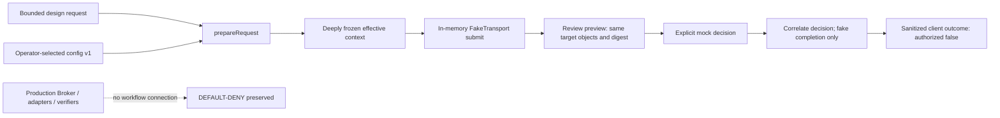

# Phase 4B — canonical preparation and offline review/client integration

Baseline: `85f060a0acdf132c6a78aaa52147f674239f2e5b`.
GO covers this offline, non-authorizing prototype only. USER retains final authority;
Codex coordinates; model results, authentication, hashes and mock decisions grant no
authority. Production batch authorization remains DEFAULT-DENY. Real Windows Hello,
credentials/proofs, live dispatch, IPC/services and deployment remain NO-GO.

## Working integration and workstream completion



| Workstream | Implemented evidence |
| --- | --- |
| A | `prepare-request.js` resolves one canonical action with existing config, registry validation and hashes |
| B | Compatibility matrix below; narrow legacy null guard and regression; no other live route change |
| C | Frozen config/action snapshot, ordered identities and context digest; mutation tests |
| D | `review-preview.js` + usable `preview-cli.js`; actual prepared context reaches the review without serialization/IPC |
| E | `fake-workflow.js` integrates preparation, fake submission, review, correlated decisions and outcomes |
| F | `workflow.test.js` exercises the real multi-component seam with fake clocks/timers and positive controls |
| G | Bounded admission, finite diagnostics, cancellation/expiry/uncertainty rules and no automatic retry |
| H | This consolidated implementation record, state matrix, limitations and Phase 4C gates |

## Canonical preparation API

All new workflow modules live in `experiments/integration-contracts/`.

```javascript
const context = prepareRequest(request, operatorConfiguration, {
  now: trustedTestClockMilliseconds,
  expiresAt: request.createdAt + 60_000
});
const result = await runPrepared(context, {
  transport: new FakeTransport({ now: () => trustedTestClockMilliseconds }),
  now: () => trustedTestClockMilliseconds,
  onReview: review => review.decide("REJECT")
});
// Or runRequest(request, operatorConfiguration, {now, expiresAt, transport, onReview}).
// Every result is non-authorizing, including MOCK_COMPLETED.
```

The request is the existing Phase 4A `request` definition: schemaVersion 1,
SYNTHETIC_DESIGN_ONLY, requestId/batchId/sessionId/createdAt and 1–8 explicit targets
with id/provider/model/task/effort/timeoutSeconds. No second request schema is added.
`check-contracts.js` exposes its existing bounded JSON guard/shape checking as
`checkRequest` and `snapshotJson`; existing scenario/cancellation semantics are retained.
Unknown fields/versions, non-JSON/accessor/cyclic values, excessive depth/nodes/bytes
and malformed text reject. IDs and models use the existing design alphabet/limits.

Configuration is a bounded cloned value validated by existing `validateConfig` v1.
No configuration file is chosen by request metadata. The caller supplies the
operator-selected configuration; this is an explicit trust assumption, not an
authenticated deployment identity. No environment is read. Credential values are
rejected by the existing config schema; credential environment *names* are retained
as configuration metadata, without reading values.

`ProviderRegistry.prototype.validateRequest` supplies existing allowlist/parameter
validation without constructing a registry, adapter or provider process. Preparation
requires explicit models/timeouts/effort, then trims the task into one effective
string. Interior CRLF, Unicode and whitespace are preserved; no NFC or newline rewrite
is performed. The existing hash helpers are reused without a new cryptographic protocol.

The prepared context contains request/batch/session IDs, ordered target IDs, exact
effective text/task hash, provider/model, resolved endpoint, exact model/messages
wire body, effective registry timeout, adapter configured timer and effort metadata.
It includes the frozen normalized configuration, config/batch/context digests,
creation/expiry, UNESTABLISHED application/user identities, SYNTHETIC_DESIGN_ONLY,
authorized:false and DEFAULT_DENY. It contains no nonce, assertion, signature,
credential ID, grant or production proof envelope.

Configuration fingerprint reuses the Phase 4A projection:

```text
configurationFingerprint({ configuration: validatedSnapshot,
  targets: [{id,providerId,modelId,destination,effort,timeoutSeconds}, ...] })
batchSha256 = existing WebAuthn batchSha256([{providerId,modelId,task}, ...])
contextSha256 = sha256Text(canonicalJson(all prepared fields except contextSha256))
```

The context digest additionally binds the exact wire representation, request and
target identities, timestamps, timeouts and non-authorizing designation. Batch digest
alone does not cover target IDs; the context does. Full configuration inclusion is
conservative: even unrelated config changes can invalidate identity. Digests establish
consistency only, never producer authentication or USER consent.

Objects/arrays are deeply frozen and detached from request/config objects. A local
WeakSet recognizes objects created by preparation; copied/decoded JSON is refused by
preview/transport. This stops accidental substitution within the prototype, not a
hostile same-process attacker. It deliberately provides no generic JSON trust bridge.
Lifetimes are positive UTC milliseconds, at most five minutes, within JS Date range;
caller-supplied clocks must be valid and not precede context creation.

## Compatibility matrix and scoped defect correction

| Concern | Phase 4B decision |
| --- | --- |
| Legacy JSON null | Confirmed `body.task` dereference; add only `body === null` to existing invalid-task guard. Regression verifies 400 invalid_task, zero fake calls, then a normal request succeeds. This route is never used by the new workflow. |
| Trim versus raw hash | Resolve effective task once before hashing/display/wire. Raw outer whitespace is not part of the transmitted action; interior bytes are retained. |
| CLI absent/null model | CLI contexts unsupported. No invented string model or new approval protocol. |
| Slash-bearing models | Existing design/offline digest alphabet rejects them; never rename/truncate. Config's broader allowlist remains unchanged. |
| Explicit API model | Must match enabled operator config exactly; no hidden model/default rewriting. Disabled or missing targets reject. |
| API destination | Derived solely from normalized operator baseUrl plus `/chat/completions`; public HTTPS URLs allowed by existing config validation can be represented offline, never contacted. Fixture/demo uses `.invalid`. |
| Non-idempotent trailing slashes | Config and adapter each strip one trailing slash. If the normalized base still ends in `/`, preparation rejects DESTINATION_NORMALIZATION_UNSUPPORTED rather than displaying a different endpoint. No adapter semantics change. |
| Effort | Preserved as requested metadata, explicitly NOT_SENT_BY_API_ADAPTER; absent from wire payload. |
| Timeout | Show effective registry deadline and configured adapter timer separately. Effective timeout must fit the provider bound; no claim that abort undoes processing. |
| Transport/identity | Local recognized objects and fake transport only; no origin/RP/credential/issuer choice or trusted application assertion. |

The prepared wire body/endpoint are compared against the existing API adapter in a
test with injected fake fetch and a synthetic test-only credential value. That test
does not route the new workflow through the adapter or make a network request.

## Usable review preview and WPF limitation

Run from repository root with installed Node:

```powershell
node .\experiments\integration-contracts\preview-cli.js
node .\experiments\integration-contracts\preview-cli.js --reject
node .\experiments\integration-contracts\preview-cli.js --cancel
node .\experiments\integration-contracts\preview-cli.js --approve-mock --partial
```

The default command prepares the checked-in synthetic request/config fixture using
the current time and a 60-second expiry, submits that actual immutable object to
FakeTransport and displays the resulting review. Choose r/reject, c/cancel or
a/APPROVE_MOCK. Unknown input rejects. The overall expiry closes a pending review;
no stale response can reopen it. Scripted flags use the same path, not a separate UI
mock. Live timestamps mean CLI transcripts are not byte-reproducible; tests inject
fixed clocks and produce deterministic context/outcome identities.

Preview targets are the exact frozen target array from preparation. Text shows full
ordered task/provider/model/endpoint/wire parameters, timeouts, request/batch/context
identity, UTC expiry, identity limitations and SYNTHETIC / NO DISPATCH. Task and wire
values use reversible JSON quoting; terminal controls, bidi controls and separators
are escaped rather than allowed to impersonate UI. Tests decode the displayed task
and compare it with the effective wire task. Preview content is deliberate visible
review data, not an audit log; diagnostic outcomes omit task/config/advisory content.

The WPF Mock, fixed default proposal, Escape-to-reject, expiry logic and
read-only diagnostics are unchanged. Cross-runtime WPF loading would require a new
serialized-context/display validation boundary. A plain JSON file would lose the
local object identity and must not automatically be trusted. This batch therefore
uses the permitted offline preview in the preparation runtime; **no WPF preview mode
or authenticated IPC is claimed**. The Node preview is connected to real preparation,
review and client handling, rather than another disconnected fixed-proposal screen.

## Fake transport, lifecycle and diagnostics

FakeTransport is an injected in-memory port. It holds at most 32 request/context IDs
per instance without eviction; duplicate identical delivery and conflicting reuse
reject deterministically. There are no sockets, fetch/process calls, adapter factories
or persistence in the built-in transport. Injected clock/timer/Promise behavior is
trusted test code, not a sandbox for arbitrary hostile JavaScript.

`submit` returns the same context and a review acknowledgment. Client checks object
identity, request ID and digest before displaying review. Decisions must be the exact
terminal record captured by that review, not an unsigned lookalike object. An explicit
APPROVE_MOCK permits only fake completion; rejection never enters fake processing.
Responses are projected to bounded target ID/status/error categories in original
target order. Advisory text, signatures, approval flags and arbitrary metadata are
not evaluated or echoed. Results are immutable snapshots.

| Current phase / event | Observed state | Behavior |
| --- | --- | --- |
| Preparation fails or pre-submit cancellation | NOT_SUBMITTED | No transport admission; fixed reason/category, no unvalidated IDs |
| Valid preparation then admission | PREPARED → SUBMITTED | History distinguishes local preparation from fake delivery; no external transmission |
| Pending review rejects | REJECTED | No fake processing; terminal review cannot reopen |
| Pending review cancels or signal aborts | CANCELLED | Close review; late approval cannot continue |
| APPROVE_MOCK then all fake targets succeed | MOCK_COMPLETED | authorized:false, DEFAULT_DENY; not actual provider completion |
| Mixed fake success/failure | PARTIAL | Preserve ordered per-target IDs and sanitized failures |
| All fake targets fail / known pre-processing transport failure | FAILED | No fabricated success/authorization; fixed reason |
| Any unknown target or simulated lost processing response | OUTCOME_UNKNOWN | Require reconciliation conceptually; no automatic retry |
| Timeout/cancellation before processing | FAILED / CANCELLED | NOT_STARTED; close pending review |
| Timeout/cancellation after potential fake processing | OUTCOME_UNKNOWN | MAY_HAVE_STARTED; cancellation does not undo processing |
| Expiry at any pending/processing boundary | EXPIRED | Late results cannot revive; MAY_HAVE_STARTED remains explicit if processing began |
| Duplicate/conflicting delivery or capacity/result-ID rejection | NOT_SUBMITTED | No second admission; existing terminal outcome unchanged |
| Acknowledgment/decision mismatch | FAILED | No processing based on substituted identity |

Review states are Pending → ApprovedMock/Rejected/Cancelled/Expired. Repeated terminal
decisions return the same record. Client/transport terminal outcomes are locked even
if a delayed decision or Promise resolves. The client deadline is min(timeoutMs,
remaining lifetime), with default 30 seconds and maximum five minutes; listeners and
timers are removed on exit. There is no background runner, retry loop or recovery
service. An invalid clock fails closed with a fixed diagnostic.

Outcome fields are schemaVersion/designation, validated request/context identity,
status/reason, NOT_STARTED or MAY_HAVE_STARTED, authorized:false, DEFAULT_DENY,
per-target sanitized results and client phase history. Preparation errors additionally
have a finite errorCategory. Raw exceptions, tasks, config URLs/credentials and worker
content are not diagnostics. No real USER-decision provenance or authorization is
implied by the local mock-record identity check.

All delivery/decision state is process-local and lost on replacement/restart. A new
transport can admit an old still-valid context after a fresh mock review. This is
not durable replay prevention. The existing synthetic recovery journal is untouched;
the small admission map is not a competing journal, persistent ledger or recovery model.

## Verification and next-step gates

`workflow.test.js` covers preparation/hashes, config/request/order immutability,
display/wire identity, destination/config/parameter changes, supported compatibility,
mock rejection/approval, pre/post-submit cancellation, expiry before/during review
and processing, timeout, failure/unknown/partial results, duplicates, late replies,
correlation mismatch, capacity, clock failure and tainted advisory diagnostics.
It includes accepting controls. Existing 4A assertions remain intact; new Node tests
are discovered by the existing five-job CI structure without a workflow change.

Full local counts, four-build results, CLI executions, policy/candidate checks and
exact-baseline patch validation are recorded in `%LOCALAPPDATA%\Temp\phase-4b-delivery.md`.
No live provider or real credential operation is introduced or tested by this workflow.

| Gate | Decision / remaining dependency |
| --- | --- |
| Integrate Phase 4B | GO after the full regression/build and exact-baseline patch checks pass |
| Begin Phase 4C on a new USER instruction | Choose Windows deployment/threat model; reuse this preparation seam and define the cross-runtime review boundary explicitly |
| WPF connected preview | Needs reviewed serialization/display binding and deliberate fixture mode; keep fixed review UI behavior and no authorization; no JSON-is-trusted shortcut |
| Authenticated local IPC/application identity | USER must select principals, installation/update ownership, privileges and same-user attacker assumptions before implementation |
| Real operational recovery | Requires approved storage ownership, durable operation/consumption transaction, restart/rollback and unknown-outcome policy; no synthetic snapshot promotion |
| Real enrollment/assertion/enumeration/deletion, credential/proof persistence | NO-GO; separate explicit USER decisions and trusted lifecycle/origin/RP/custody design |
| Production authorization, live provider dispatch through this workflow, services/deployment/publishing | NO-GO; separate security review and USER authorization |

Phase 4C should connect the established preparation/review interface to the selected
deployment model, not introduce another orchestrator or synthetic hardening framework.
Same-user process metadata, signature validity and matching digests still cannot
establish USER approval. No further scope or sensitive mechanism is selected automatically.
