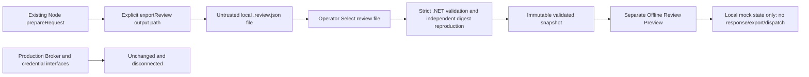

# Phase 4C — Windows offline review integration and identity readiness

Baseline: `c8e22b08aa659d199f38d9d419448f687e577284`, committed Phase 4B.
GO is limited to the offline preview integration. Real credentials, authenticated IPC,
trusted approval proofs, production authorization, live dispatch and deployment remain
NO-GO. USER remains final authority; Codex coordinates; other models are advisory.

## Working architecture and eight-workstream disposition



| Workstream | Delivered implementation |
| --- | --- |
| A | One review-file v1 envelope carrying the existing Phase 4B context; existing digest semantics ported exactly |
| B | Deterministic recognized-context export, explicit new local file selection, bounded UTF-8 and no handoff |
| C | `OfflineReviewValidator` / `ReviewJson`: strict parsing, schema, bounds, Unicode, URLs, relationships and independent hashes |
| D | Separate `OfflineReviewWindow` with shared original UI resources; explicit selector and immutable per-target display |
| E | `OfflineReviewViewModel`: pending, approve mock, reject, cancel, expire, reload and stale-context guards; no decision exporter |
| F | Actual Node CLI export invoked by .NET tests, byte-identical golden vector, independent validation/display and hostile mutation tests |
| G | Windows identity decision dossier below; no identity/IPC mechanism selected or enabled |
| H | This consolidated contract, behavior, threat model, operational limits and next-step gates |

## Export API and operator workflow

From repository root with installed Node:

```powershell
node .\experiments\integration-contracts\export-review-cli.js --output "$env:LOCALAPPDATA\Temp\example.review.json"
```

The output must be a new absolute local `.review.json` file in an existing regular
directory. Existing files are never overwritten. Relative/UNC/device/alternate-stream,
traversal, control-character, reserved-device and unsupported-extension paths reject;
ancestor symlinks/junctions reject. Export validates before creating output. A write
failure can leave a partial new file; the viewer rejects incomplete content. There
is no directory watcher, process launch, automatic WPF handoff or live service.

Run the existing WPF Mock separately. Its fixed proposal remains the default. Choose
**Offline Review Preview…**, then **Select review file…** in the new window and
explicitly choose the exported file. This operator action selects data for validation,
not a trusted producer or an approval request. Existing standalone Node CLI review
and all prior scripted options remain unchanged.

The library API `serializeReview(context, now)` returns deterministic UTF-8 bytes;
`exportReview(context, outputFile, now)` writes only recognized prepared objects.
The context comes from existing `prepareRequest`; copied JSON cannot be exported as
a recognized context. The file boundary intentionally loses that in-process object
identity, so .NET treats every file as hostile and rebuilds a validated display snapshot.

`--fixture` generates the checked-in fixed-clock interoperability vector rather than
a fresh review. It is for tests; the real window never bypasses creation/expiry checks.
Use the normal command for a currently loadable review. Files carry complete task
content; choose an operator-controlled location. No environment credential value,
signature, assertion, credential ID or approval proof is read or exported.

## Review-file v1 contract and digest rules

The envelope has exactly:

```text
reviewFileSchemaVersion: 1
designation: SYNTHETIC_DESIGN_ONLY
producerAuthentication: NONE
context: the existing immutable Phase 4B prepared representation
```

The context requires exactly schemaVersion, designation, requestId, batchId,
sessionId, createdAt, expiresAt, applicationIdentity, userIdentity, authorized,
productionAuthorization, normalization, orderedTargetIds, targets,
configurationSnapshot, configurationFingerprint, batchSha256 and contextSha256.
Version is 1; identities are UNESTABLISHED; authorization is false / DEFAULT_DENY;
normalization is ECMASCRIPT_TRIM_UTF8_V1. No approved/grant/proof fields exist.

Every target contains id/providerId/modelId/destination, complete effective task and
taskSha256, exact model/messages wire object, effective/configured timeouts and
requested effort metadata. The validator checks the same ordered IDs, enabled
allowlisted provider/model, exact config-derived endpoint, exact wire model/task,
task hash, timeout relationship and NOT_SENT_BY_API_ADAPTER effort classification.
It never reinterprets request-only effort as a wire parameter.

One canonical algorithm is used: the existing `approval-core.js:canonicalJson`
semantics, independently ported in `ReviewJson`. Keys sort by ordinal UTF-16 code
units; arrays retain order; strings use ECMAScript JSON.stringify escaping without
Unicode normalization; safe integer numbers use ordinary decimal. Well-formed
surrogate pairs encode to UTF-8. Control escapes use lowercase hex; CRLF and combining
sequences remain distinct. The .NET parser rejects non-integer numeric spellings
rather than guessing at a broader JSON-number profile. SHA-256 is lowercase hex.

```text
taskSha256 = SHA256(UTF8(effective task))
configurationFingerprint = existing configurationFingerprint({
  configuration: configurationSnapshot,
  targets: [{id,providerId,modelId,destination,effort,timeoutSeconds}, ...]
})
batchSha256 = SHA256(UTF8("orchestrator-approval-batch-v1\0") ||
  UTF8(canonicalJson([{providerId,modelId,taskSha256}, ...])))
contextSha256 = SHA256(UTF8(canonicalJson(context excluding contextSha256)))
file bytes = UTF8(canonicalJson(envelope) + LF), no BOM
```

No second hash representation or approval protocol is introduced. .NET validates
task, configuration, batch and context hashes independently before constructing the
display model. Reordered fields/whitespace can still validate because identity is
canonical data; exported bytes themselves are deterministic. Matching hashes do
**not** authenticate producer, application, process, USER or decision provenance.

The portable profile is bounded at 262144 file bytes, JSON depth 16, 1–8 targets,
1–16 API configuration entries and 1–32 models per entry. IDs are ASCII 1–64;
target models use the existing offline/design alphabet up to 128; task lengths are
at most 50000 UTF-16 units. Time uses positive UTC Unix milliseconds, at most five
minutes lifetime and within .NET DateTimeOffset range. Future/stale files reject.

CLI configurations, slash-bearing selected models, non-API snapshot entries and
URL shapes outside the portable profile are explicitly unsupported. API bases use
normalized lowercase ASCII DNS names, HTTPS, optional normalized nondefault port and
unescaped ASCII path segments; credentials, query/fragment, IP/local/internal hosts,
dot segments, ambiguous percent escapes and non-idempotent trailing slashes reject.
This is syntactic consistency, not DNS/egress or server-identity verification. Existing
provider configuration and adapter execution behavior are unchanged.

## WPF integration and lifecycle

`MainWindow.xaml` adds only a menu entry; its two original buttons, layout/resources,
fixed task, keyboard handler, expiry and diagnostics remain. `OfflineReviewWindow`
reuses the owner's existing fonts, brushes, cards, button styles and focus ring.
Its warning is **OFFLINE SYNTHETIC PREVIEW — NO DISPATCH**. Complete ordered tasks,
wire bodies, provider/model/endpoint, timeouts, metadata, request/batch/session/context
identity, config fingerprint, expiry and local state are shown in read-only bindings.
Wrapping text, bounded task/wire scroll areas, outer scrolling and a fixed decision
footer preserve access for long content. Neither window executes file-supplied data.

`OfflineReviewValidator.ReadFile` checks local path/attributes, rejects reparse points,
bounds the stream before parsing, uses fatal UTF-8, rejects nested duplicate keys,
unknown/missing/typed fields, invalid Unicode/IDs/URLs/digests/authority markers and
inconsistent relationships. It does not deserialize arbitrary type metadata or load
XAML from the file. Only the trusted compiled window supplies markup/resources.

The view model publishes a new snapshot only after complete validation. Invalid
loads retain the prior context and state and report only a fixed error category.
Targets are read-only immutable model records, not a live JsonDocument or editable
request. UI values derive from this exact validated snapshot. No decisions are
returned to Node, Broker or disk.

| Event | State / behavior |
| --- | --- |
| New window | NoFile; decision actions disabled |
| Explicit valid file selection/reload | Pending; new explicit review even after prior terminal state |
| Approve Mock / Reject / Cancel | ApprovedMock / Rejected / Cancelled; local and in memory only |
| Escape | Reject current pending preview; fixed default window's original Escape behavior remains |
| Timer/decision observes expiry or invalid backward clock | Expired; pending approval disabled; no delayed action can revive |
| Repeated terminal decision | Refused; original terminal state retained |
| Invalid file replacement | Current snapshot/state retained; sanitized status only |
| Wrong request/session/context or stale local review-generation decision | Refused; no state transition or grant |
| Close window | Timer stops; pending review cancelled locally |

Each successful load increments a local review generation, so a decision captured
before even an identical-file reload cannot apply to the new review. This is transient
UI bookkeeping, not a nonce, trusted token, journal or durable replay store.
Already terminal mock states remain terminal as in the original Mock. Reload does
not resume a previously approved state. No durable consumption/replay guarantee is
made: a copied unexpired file can be explicitly reviewed again. The system is not
capturing independently authenticated consent.

Failure categories are finite `REVIEW_*` values: file/path/read/oversize, UTF8/Unicode/
JSON/duplicate/number/type/string/collection, schema/unknown/required field,
ID/digest/URL/config/target/order/time/metadata/authority, task/wire/timeout binding
and task/config/batch/context hash mismatch. No path, task, raw exception, credentials
or proof bytes appear in UI diagnostics. Complete task content appears only in the
deliberate review display and the selected data file.

## Cross-runtime verification and limitations

`golden.review.json` is produced by actual Node preparation/export and contains
supplementary emoji, combining accents, café, CRLF, quotes, backslashes, controls and
U+2028/U+2029. Node tests compare deterministic bytes with that vector. The .NET Mock
suite actually starts the fixed Node export CLI in a bounded temporary test directory,
compares exported bytes, independently validates all hashes, then loads the file into
the display view model. Node is invoked by the **test harness only**, never WPF.

Negative tests exercise changed text/order/destination/wire/fingerprint/session,
authority promotion, schema/unknown/missing/type errors, nested duplicates, oversize,
invalid UTF-8/Unicode, unsafe paths and expiry. Positive accepting controls guard
against blanket rejection. All original 434 assertions remain; counts/results and
exact reproduction commands are in `%LOCALAPPDATA%\Temp\phase-4c-delivery.md`.

The Windows .NET CI job explicitly sets up Node 24 before its existing Mock test
command, so it executes real interoperability tests. The matrix remains exactly
five jobs with contents:read and no publication. Local builds/headless model/XAML
contracts are not a manual visual/DPI/high-contrast/screen-reader pass; that Windows
UX acceptance remains separate. Untrusted text can contain visually ambiguous Unicode;
no claim of informed real consent is based on this preview.

Filesystem checks assume an operator-controlled stable local directory. They are
not producer authentication or protection against a privileged concurrent directory
replacement attack. File hashes cannot stop a malicious producer from recomputing
an entirely consistent synthetic file. Such data remains display-only. Review files
do not constitute durable audit, decisions, proof or trusted replay state.

## Windows identity decision dossier — no mechanism selected

Existing evidence: `broker.js` has no trusted approval requester; batch uses a bearer
token then DEFAULT-DENY. `webauthn-approval.js` requires caller-pinned trust anchors
but is isolated. WPF displays local mocks; diagnostics report capability only. Phase
4C files explicitly assert NONE/UNESTABLISHED. No source establishes real application
identity, protected decision provenance or durable consumption.

Process metadata (PID/path/session string) is distinct from OS user identity, installed
application identity, user authentication, explicit context-bound approval and final
policy authorization. Even a valid signature proves only a key/byte relationship
under stated trust assumptions. It does not prove which UI displayed those bytes or
that USER explicitly authorized that exact operation.

| Requirement / threat | Single-user local desktop | Installed application + separately protected approval component | Browser-owned approval + reviewed local bridge |
| --- | --- | --- | --- |
| Windows USER/process | Define intended OS principal and process/session scope; same-user processes are not automatically trusted | Bind requester/component to reviewed installed identities and OS principals | Browser user/origin plus bridge OS principal must be related explicitly |
| Install/update ownership | User-owned files simplest, weak integrity assumptions | Controlled installer/update ownership and verification required | Browser/origin deployment plus local bridge update ownership required |
| Same-user malware | Must explicitly accept or mitigate impersonation/UI/state tampering; simple separation insufficient | Protection boundary/privilege and UI ownership must be demonstrated, not assumed from package name | Origin isolation helps define web provenance; local malware/bridge impersonation remains |
| Administrative attacker | State whether outside threat model; local admin can undermine ordinary local assets | Requires explicit stronger trust-root assumptions; installer/signing alone is insufficient | Endpoint/bridge/browser compromise assumptions still necessary |
| IPC authentication | Authenticate both endpoints and session, reject spoof/replay; loopback/path is not identity | Protected component must verify caller principal, installed identity and channel/session binding | Authenticate origin-to-bridge and bridge-to-Broker independently |
| Protected UI ownership | No evidence from this mock that independent UI ownership exists | Define who owns/displays UI and who can modify/impersonate it | Trusted browser origin and bridge UI boundaries must be specified |
| Request provenance | Shared token/process metadata insufficient | Derive authenticated requester/config/context at trusted boundary | Bind exact web origin, local requester and effective action |
| Decision provenance | Local button state is not independently authenticated consent | Separate explicit USER decision capture from authentication and signing | Browser authentication still needs explicit context-bound consent |
| Trust-root custody | USER must choose protected identity/key ownership; none created here | Installer/component/key custody, revocation and updates need review | Origin/RP/domain/bridge key ownership and revocation need review |
| Storage/rollback | In-memory maps/files inadequate for real consumption | Durable atomic operation/consumption/audit with integrity and rollback policy | Durable browser/server/bridge state consistency and rollback policy |
| Explicit consent | Complete displayed/effective action and fresh decision required | Protected display plus exact operation binding required | Origin-bound display still must show exact intended action/target |
| Operational complexity | Lowest setup cost, weakest default threat separation | Higher installation/privilege/update/recovery burden | Adds origin/domain/browser/bridge operations and trust boundaries |

Before Phase 4D security-sensitive work, USER must decide single/multi-user and
local/remote scope; same-user/admin attacker assumptions; allowed installation and
privilege model; requester/Approval Agent/UI ownership; application/update trust roots;
credential/authenticator custody and origin/RP convention if ever approved; storage
integrity/rollback/recovery policy; and what evidence establishes explicit consent.
No option is chosen automatically and none authorizes real credentials or IPC now.

## Closure and minimal next milestone

| Decision | Status |
| --- | --- |
| Integrate Phase 4C offline Node → file → validated WPF preview | GO after regression/build/exact-baseline patch checks |
| Manual Windows visual/DPI/accessibility acceptance | Required observation before claiming UX accessibility; not a security grant |
| Next engineering milestone | USER deployment/principal decision, then a bounded Phase 4D design/implementation proposal for the selected boundary, reusing this context/display seam |
| Real authenticated IPC, identity mechanism, services or persistence | NO-GO without separate explicit USER decisions and scoped review |
| Real Windows Hello operations, new trusted proofs, production authorization/live dispatch/deploy/publish | Hard NO-GO |

Production blockers remain authenticated requester/application/UI/decision provenance,
trusted credential lifecycle/origin/RP/custody, durable atomic replay/operation state,
rollback resistance, unknown external outcome recovery and reviewed deployment. The
working offline file preview does not solve or imply any of those capabilities.
