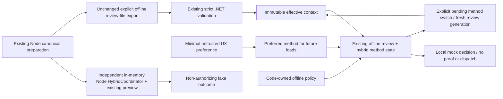

# Phase 4D — offline hybrid approval foundation

Baseline: `acd7bb283cae2e06ada00f02cb16666a22bbe5f0`, committed Phase 4C.
This implements selectable methods and local coordination, not production approval.
USER remains final authority; Codex coordinates; AI providers are advisory; the
Broker remains deterministic and batch authorization DEFAULT-DENY. Preferences,
matching hashes and mock decisions establish no authenticated identity or authority.

## Implemented architecture and eight workstreams



There is no automatic Node/WPF synchronization, decision handoff, file watcher,
transport, service or second orchestrator. Node uses `assertPrepared` and the
existing `createReview` preview. WPF extends the existing `OfflineReviewViewModel`
rather than introducing a competing lifecycle. The existing Phase 4B fake client
remains separate; a hybrid mock decision is never supplied to a production verifier.

| Workstream | Implementation evidence |
| --- | --- |
| A | `Models/HybridMethods.cs`, `hybrid-review.js`: stable immutable method catalog and explicit code-owned policy |
| B | `OfflineReviewWindow.OfferOnboarding`, `ApprovalMethodWindow`: first-use explicit selection, cancellable and separate from legacy startup |
| C | `ApprovalMethodPreferences`, `ApprovalMethodSelection`: bounded versioned preference, settings/save/reset, next-launch restore |
| D | `OfflineReviewViewModel.SwitchMethod`: pending-only explicit switch, unchanged action/expiry and fresh generation |
| E | Existing WPF lifecycle extended; pure Node `HybridCoordinator`; strict correlation and no fallback |
| F | Separate method-selection dialog, current/default indicator, settings, pending picker and unchecked optional default |
| G | Existing harness extended with production settings/selection/coordinator tests, including actual Phase 4C interoperability |
| H | This consolidated implementation, operational limits and ordered USER decision gates |

## Method and capability matrix

| ID / product choice | Availability now | Offline actions | Prerequisites for real use | Assurance now |
| --- | --- | --- | --- | --- |
| `LOCAL_DESKTOP` / A | Functional local WPF review | Validate file, display, mock approve/reject/cancel/expire | Explicit local trust/principal/UI ownership model | UNESTABLISHED; no authenticated transport or real authorization |
| `PROTECTED_WINDOWS` / B | Local simulation only | Same local mock lifecycle | Protected component identity, installation/update ownership, privilege boundary, authenticated IPC | UNESTABLISHED; no protected component created |
| `REMOTE_BROWSER` / C | Local simulation only | Same local mock lifecycle; no browser/device communication | Device registration, browser origin, authenticated channel, revocation and cross-device state | UNESTABLISHED; no pairing or remote connection |

B may eventually underpin local and remote interaction modes. A/B/C are
product-facing choices, not three equivalent security mechanisms. Metadata exposes
description, availability, prerequisites, supported actions, assurance, simulation
and transport/identity status. All transport/identity flags are false. Unsupported
or contradictory catalog metadata fails closed. No method is production-capable.

## First use, settings and persistence

The fixed-proposal MainWindow is unchanged and remains startup mode. Opening its
existing Offline Review Preview starts the hybrid experience. On first use without
a valid preference, a method-selection dialog explains A/B/C and requires an explicit choice
to save a preference. Cancel or Escape dismisses setup and leaves the existing
offline local preview usable. No mandatory migration or administrator action.

**Method Settings** can save A/B/C or explicitly reset the preference. The dialog
lists availability and setup prerequisites; B/C are labelled simulation. Reset
removes only the UX preference and makes onboarding available on subsequent use.
Preference changes affect subsequent explicit file loads/windows, never an already
pending or terminal review. A missing/corrupt setting uses legacy local preview as
the unset-preference behavior, not as a policy fallback; policy can still deny A.

Production preference path:
`%LOCALAPPDATA%\ApprovalAgent.Mock\approval-method.json`.
The application creates it only after explicit Save or opt-in set-as-default.
Tests inject isolated temporary paths and never touch the real preference.

Exactly two fields are accepted, with maximum 1,024 UTF-8 bytes:

```json
{"preferredMethod":"LOCAL_DESKTOP","schemaVersion":1}
```

Serialization has fixed property ordering, UTF-8 without BOM and trailing LF.
Read checks size before parsing, uses bounded streaming, fatal UTF-8 decoding and
existing strict duplicate/Unicode/depth checking, then rejects unknown/missing
fields, invalid IDs/types or unsupported version. Invalid data produces sanitized
status and an unset preference, never permissions. Save uses a unique same-directory
temporary file and replacement; failures leave the in-memory default unchanged.
Reset/save/read errors do not expose paths or exception messages. Interrupted
temporary cleanup may leave a non-secret temporary preference file; no security
state or durable transactional guarantee is claimed.

No task, context, allowed-target list, policy, identity, credential, grant or decision
is persisted. User tampering may change UX choices only. This ordinary user-owned
file is not protected configuration or a trusted audit/replay store. Concurrent
application instances are last-successful-save-wins, with no synchronization.

## Preference, selection and policy

Preferred method is UX data. Selected method is local state for the current context.
Availability describes offline functionality/simulation. Code-owned `HybridPolicy`
separately allowlists method IDs and requires `OfflinePreview`, `ProtectedIdentity`
or `RemoteIdentity`. The UI exposes no security-policy editor. Unknown/duplicate
policy IDs and unknown requirements reject. An empty allowlist permits nothing.

The current catalog cannot satisfy either real-identity requirement. A stronger
requirement is denied for A, B and C; simulations never fulfill protected identity.
An unavailable preferred method stays visibly selected and decision-disabled;
there is no automatic fallback. An explicit eligible switch is possible under an
offline policy. Preferences cannot alter policy or turn `authorized` true.

## Pending switch and correlation rules

The review card shows current method, its description/policy availability and the
future default. **Change Method** is enabled only while Pending. Opening the picker
captures request ID, session ID, context SHA-256 and review generation. Apply checks
current expiry, correlation and policy again after the dialog interaction.

An actual method change increments the review generation, retains the exact
immutable `Context` reference and original expiry, and stays Pending. Same-method
selection is an intentional no-op with the same generation. Method state is never
inserted into the Phase 4C file, configuration fingerprint or effective-action
digest. Old generation decisions/switches, mismatched request/session/context and
callbacks from earlier identical-file loads reject.

**Set as default for future requests** starts unchecked. Successful Apply without
that option leaves the preference alone. Opt-in saves only after a valid switch.
If saving fails, the valid local switch remains but the default is unchanged; the
dialog reports that distinction. Expiry, stale context or denied switch cannot
save a preference through this option. Settings save is a separate UX operation.

| Event | State/result |
| --- | --- |
| No file | NoFile / NO_REQUEST; no switch or decision |
| Valid explicit file load / Node begin | Pending with selected preferred method or unset local behavior; new generation |
| Invalid replacement | Prior context, selection, generation and terminal state retained |
| Eligible different method | Pending; generation increments; action and expiry unchanged |
| Same method | Pending; no generation change or automatic mock decision |
| Denied/unknown method or stale picker | No selection/default change; sanitized failure |
| Expiry or invalid clock during review/switch | Expired; no later method/decision revival |
| Mock approve, reject or cancel | ApprovedMock / Rejected / Cancelled; terminal, local only |
| Duplicate decision / terminal switch | Reject; terminal state retained |
| Explicit file reload / Node begin after terminal | New review generation, not revival of previous decision |

Generation is local in-memory correlation, not authenticated decision provenance,
a production token or durable replay prevention. Restart loses generation/state;
a still-valid file can be explicitly reviewed again. No stronger claim is made.

## APIs and actual integration

WPF:

- `HybridMethods.All/Find/Valid`: immutable catalog; `HybridPolicy.Check` supplies
  fixed policy categories independently of preference.
- `ApprovalMethodPreferences.Read/Save/Reset`: injected-path minimal UX storage.
- `OfflineReviewViewModel.SetPreference`: future-load preference only;
  `SwitchMethod(id, requestId, sessionId, digest, generation)`: guarded local switch;
  existing `Decide` guards the same review generation and exact context.
- `ApprovalMethodSelection.Apply(id, setAsDefault=false)/Reset`: actual dialog
  operations with captured correlation, store integration and sanitized feedback.

Node, using the actual prepared context:

```javascript
const { HybridCoordinator } = require('./experiments/integration-contracts/hybrid-review');
const hybrid = new HybridCoordinator({ now: fakeClock, preferredMethod: 'LOCAL_DESKTOP' });
const pending = hybrid.begin(preparedContext);
hybrid.switchMethod('PROTECTED_WINDOWS', pending.correlation); // local simulation
const current = hybrid.view();
hybrid.decide('REJECT', current.correlation);
// Every view/outcome: authorized:false, productionAuthorization:'DEFAULT_DENY'.
```

Node `view()` returns immutable preview, method, preference, state, original expiry,
generation/correlation and fixed authorization designation. `setPreference(null)`
resets the in-memory UX default. Policy options are bounded, validated and
snapshotted. No filesystem persistence or real transport is added to Node. Its
clock errors are sanitized and pending review fails closed. Correlation includes
method ID as well as generation and context identity.

The WPF dialog reuses shared owner resources, scrolls/wraps long descriptions,
supports mnemonic labels/buttons and Escape-to-cancel. The underlying review keeps
Escape-to-reject, readonly exact tasks/wire bodies, provider/model/destination,
expiry timer and current mock decisions. No new field is editable in the action.
Fixed Mock startup, native read-only diagnostics, production routes/authorizers,
provider adapters, canonicalization, export contract and old assertions are unchanged.

## Verification and limitations

Measured baseline: Mock 48, Fake Lab 60, Assurance 197, Node 154 = 459, all executed.
The added tests exercise actual production preference/selection classes and the
extended review view model, not a duplicate lifecycle. Node tests prepare real
contexts and reuse the real preview. Positive A→B→C→A switches rule out reject-all.
Existing actual Node-export→.NET validation/display interoperability remains part
of the Mock harness, and all previous assertions remain intact.

Tests cover first use, deterministic persistence, reset, corruption/version/extra
authority fields, write failures, preference isolation, no fallback, protected/remote
requirement denial, invalid metadata, context preservation, terminal/duplicate/stale
generations, picker expiry, invalid replacement, clock failures and optional default.
UI contract tests verify actual XAML bindings/actions and unchecked default control.
The existing five CI jobs discover tests without any workflow change.

| Suite / check | Measured final result |
| --- | --- |
| Approval Agent Mock | 65/65 (48 retained + 17 hybrid cases) |
| Fake WebAuthn Lab | 60/60 |
| Offline Assurance | 197/197 |
| Node.js | 165/165 (154 retained + 11 hybrid cases) |
| Total | 487/487; all 459 baseline regressions retained |
| Four .NET Release builds | PASS, zero warnings/errors |
| Policy validation and two synthetic candidate audits | PASS; candidate bytes reproducible |

These commands passed in the implementation checkout and independent exact-baseline
patch checkout. They are local execution observations, not authenticated attestations.

Final measured counts/builds, policy/candidate reproducibility and exact-baseline
patch apply/reverse/reapply evidence are recorded in
`%LOCALAPPDATA%\Temp\phase-4d-delivery.md` alongside exact reproduction commands.
Manual WPF visual, DPI, screen-reader and high-contrast testing was not executed;
headless view-model/XAML checks and successful builds do not establish that result.
No remote CI pass is claimed for this uncommitted patch.

## Security gates and practical next steps

| Gate | Status |
| --- | --- |
| Offline hybrid foundation integration | GO only with passing full regressions/builds and exact-baseline patch verification |
| Real USER consent, trusted application identity or protected UI claim | NO-GO; method selection cannot establish these |
| Real A approval, protected B component/IPC, remote/browser C communication | NO-GO pending explicit USER decisions and reviewed bounded implementation |
| Credentials, trusted proofs, production authorization/live dispatch, deployment/publication | Hard NO-GO |

Order the next work by real dependencies rather than more method-selection layers:

1. Observe the Windows UI manually at supported DPI/keyboard/accessibility settings.
   USER selects Method A's principal/deployment scope, same-user/admin attacker
   assumptions, requester/UI ownership and exact consent semantics. Then scope a
   reviewed local trust-boundary implementation; this offline file is not that channel.
2. For B, USER approves installation/update trust ownership, protected component
   identity, privilege separation, authenticated endpoint/session binding and operational
   lifecycle. Only then design and separately authorize protected IPC implementation.
   Protected Windows may serve both local and later remote UX.
3. For C, decide device registration/revocation/custody, browser origin and trust roots,
   authenticated remote channels, cross-device expiry/replay/unknown outcomes and
   durable consumption/rollback policy. No pairing or transport can be inferred from
   the C simulation.
4. Before any real method can authorize execution, review explicit consent provenance,
   action binding, durable atomic replay/operation state, recovery/revocation and a
   separately approved credential/proof lifecycle. Production wiring and release need
   separate USER authorization. No option or trust mechanism is selected automatically.
